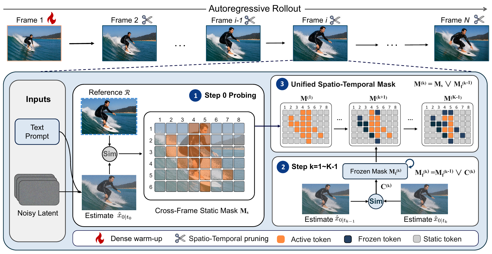
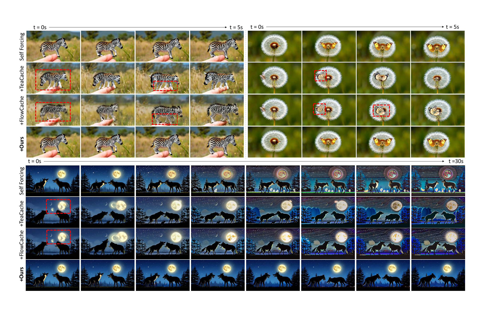

<div align="center">

# PreSTP: Training-Free Predictive Spatio-Temporal Token Pruning for Few-Step Autoregressive Video Diffusion

[](https://arxiv.org/abs/2611.07551)

[🔍 Overview](#overview) · [🎬 Results](#results) · [⚙️ Installation](#installation) · [🚀 Quick Start](#quick-start) · [📖 Citation](#citation)

</div>

## Overview

PreSTP accelerates **few-step autoregressive video generation** through predictive spatio-temporal token pruning, with applicability to models such as **CausVid, Self-Forcing, AnyFlow, and LongLive**.



### Features

- **Training-free:** plug-and-play and compatible with existing few-step autoregressive video generation models.
- **Token-level pruning:** fine-grained token caching across frames and denoising steps.
- **Attention-output & KV-cache reconstruction:** reconstruct skipped-token outputs from last-computed clean latents and recover KV-cache entries from the corresponding cached keys and values.
- **One-step applicability:** the method also accelerates one-step AR models, as evaluated in the paper.

## Results



*Paper results on Self-Forcing: 5-second examples above and a 30-second rollout below. Red boxes highlight visible degradation.*

<details>
<summary><b>Quantitative results (CausVid)</b></summary>

### 5-second generation

| Method | Speedup ↑ | LPIPS to dense ↓ | VBench ↑ |
|:--|--:|--:|--:|
| Dense CausVid | 1.00× | — | 82.91 |
| **+ PreSTP** | **1.69×** | **0.092** | 82.85 |

### 30-second generation

| Method | Speedup ↑ | Early LPIPS ↓ | Late LPIPS | VBench-Long ↑ |
|:--|--:|--:|--:|--:|
| Dense CausVid | 1.00× | — | — | 81.08 |
| **+ PreSTP** | **1.96×** | **0.156** | 0.530 | **81.36** |

</details>

## Installation

Run the following commands from the repository root. Inference requires **a BF16-capable CUDA GPU and FlashAttention**. The model, text encoder, VAE, and KV caches reside on the GPU.

### 1. Create an environment

Use Python 3.11 and CUDA 12.4 for the tested setup. [requirements.txt](requirements.txt) pins the inference dependencies.

```bash
python3.11 -m venv .venv
source .venv/bin/activate
python -m pip install --upgrade pip setuptools wheel packaging ninja
```

### 2. Install PyTorch and PreSTP

For the tested CUDA 12.4 stack:

```bash
python -m pip install torch==2.5.1 torchvision==0.20.1 \
  --index-url https://download.pytorch.org/whl/cu124
python -m pip install -r requirements.txt --no-build-isolation
python -m pip install -e .
python -m pip check
```

For other CUDA builds, choose a matching PyTorch/torchvision pair using the [PyTorch installation guide](https://pytorch.org/get-started/locally/).

## Model weights

Download the official Wan base assets and CausVid autoregressive checkpoint.

- **Wan assets:** the text encoder, tokenizer, VAE, and backbone configuration shared by CausVid. The current loader also reads the Wan diffusion weights to initialize the backbone.
- **CausVid checkpoint:** replaces the generator weights with the distilled autoregressive model used for generation.

```bash
huggingface-cli download Wan-AI/Wan2.1-T2V-1.3B \
  --local-dir weights/Wan2.1-T2V-1.3B
huggingface-cli download tianweiy/CausVid \
  --include 'autoregressive_checkpoint/model.pt' \
  --local-dir weights/CausVid
```

The expected structure is:

```text
weights/
├── Wan2.1-T2V-1.3B/
│   ├── config.json
│   ├── diffusion_pytorch_model.safetensors
│   ├── Wan2.1_VAE.pth
│   ├── models_t5_umt5-xxl-enc-bf16.pth
│   └── google/umt5-xxl/                 # Tokenizer files
└── CausVid/
    └── autoregressive_checkpoint/model.pt
```

Inference loads these assets locally.

## Quick start

### Generate a video with PreSTP

```bash
python -m prestp.infer \
  --wan-dir weights/Wan2.1-T2V-1.3B \
  --checkpoint weights/CausVid/autoregressive_checkpoint/model.pt \
  --prompts examples/prompts.txt --output outputs/prestp_5s \
  --preset 5s --method prestp --seeds 0 --limit 1
```

### Generate longer videos

Use `--preset 30s` with a new output directory, for example `--output outputs/prestp_30s`. The presets produce 81 and 501 frames at 16 FPS, respectively, at **832 × 480** resolution.

### Options

| Argument | Usage |
|:--|:--|
| `--method dense / prestp / both` | Reference, accelerated, or paired generation. |
| `--preset 5s / 30s` | Select the short or long configuration. |
| `--seeds 0,1,2,3,42` | Generate each prompt with the listed seeds. |
| `--limit N` | Use the first N prompts. |
| `--config configs/causvid_5s.json` | Load explicit settings; overrides `--preset`. |
| `--num-shards N --shard I` | Partition prompts across workers; use a distinct output directory per worker. |

Set `CUDA_VISIBLE_DEVICES` to select a GPU and use a new output directory for each run.

<details>
<summary><b>Troubleshooting</b></summary>

- **FlashAttention fails to install:** check `nvcc --version`, the PyTorch CUDA version, and compiler availability. On a memory-constrained build host, use `MAX_JOBS=2 python -m pip install flash-attn==2.7.4.post1 --no-build-isolation`.
- **Missing weights or checkpoint mismatch:** verify the directory structure above and use `autoregressive_checkpoint/model.pt`, not another checkpoint variant.
- **CUDA out of memory:** start with `--preset 5s --limit 1`, stop other GPU processes, and use a GPU with more available memory. Generation currently keeps all model components on device.
- **Output directory already exists:** choose a new `--output` directory for each run.

</details>

## Citation

If you find PreSTP useful in your research, please cite our [paper](https://arxiv.org/abs/2611.07551):

```bibtex
@misc{li2026prestp,
  title={Training-Free Predictive Spatio-Temporal Token Pruning for Few-Step Autoregressive Video Diffusion},
  author={Jia Li and Xurui Peng and Xing Wang and Hayden Kwok-Hay So},
  year={2026},
  eprint={2611.07551},
  archivePrefix={arXiv},
  primaryClass={cs.CV},
  url={https://arxiv.org/abs/2611.07551}
}
```

## Acknowledgements

We thank the authors of [CausVid](https://github.com/tianweiy/CausVid), [Self-Forcing](https://github.com/guandeh17/Self-Forcing), [Wan2.1](https://github.com/Wan-Video/Wan2.1), and [LIPAR / Streaming LIPAR](https://github.com/DennisMenn/lipar) for their open-source repositories.
